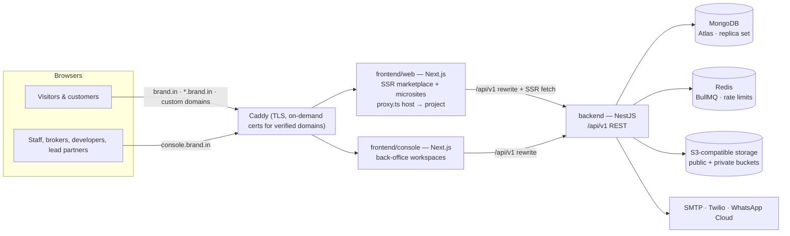

# Architecture overview

## Shape of the system

A **modular monolith**: one deployable API containing isolated business modules, two Next.js frontends and shared packages. Modules communicate through the database and explicit service calls — no microservices, no shared mutable state in the frontends.

### Applications

| App | Responsibility |
| --- | --- |
| **backend** | All business rules, validation, authorisation, persistence, background jobs, notification delivery, file storage. |
| **frontend/web** | Server-rendered public marketplace (SEO), project pages, microsites for subdomains/custom domains, customer account. |
| **frontend/console** | Back-office for every non-customer user. One app with function-oriented routes (`/listings`, `/crm/leads`, `/hr/...`); the sidebar shows only what the user's permissions allow. |

### API modules (`backend/src/modules`)

| Module | Owns |
| --- | --- |
| `auth`, `system` | Sessions, registration (customers, partners, lead providers), password flows, health/readiness |
| `catalog` | States, cities, localities, property types, amenities (public lookups + admin CRUD) |
| `properties`, `files`, `home` | Listings lifecycle, media/documents, favourites, reports; uploads & signed URLs; homepage data |
| `projects` | Projects, inventory & reservations, page builder, domains & microsite resolution, status scheduler |
| `enquiries`, `crm`, `lead-providers` | Public enquiries, leads, assignment engine, follow-ups, site visits, customers, deals & customer payments, campaigns, lead-provider portal |
| `partners`, `admin` | Partner verification & subscriptions, own-organisation management; users, roles & permissions |
| `hr`, `payroll` | Employees, org structure, attendance, leave, tasks; salary components/structures, runs, payslips, payments |
| `commissions`, `finance` | Commission rules/records/payouts; ledger, invoices, expenses, reimbursements, monthly reports |
| `cms`, `reports`, `notifications` | Pages, home sections, banners, FAQs, SEO overrides, sitemap feed; dashboards & reports; outbox delivery, templates, logs |

Why two frontends instead of five: public pages and back-office have different rendering, caching and security needs (the console is never served on customer domains and is `noindex`). Admin/broker/developer/staff/lead-partner views share most screens (a broker's "My listings" is the admin listings screen scoped by permissions), so one console avoids duplicating them. Workspaces can be split into separate deployments later without API changes.

### Shared packages

- **@estate/shared** — the contract layer: enums (kept in parity with Prisma by a unit test), Zod request schemas used by both API and forms, the permission catalogue and system roles, lifecycle state machines (property, project, unit, lead, deal, commission), pure calculators (payroll, commission, invoice totals, leave days, attendance), hostname normalisation, formatters (₹ lakh/crore).
- **@estate/ui** — design tokens (Tailwind v4 `@theme`, runtime brand colour), accessible components on Radix.
- **@estate/api-client** — typed fetch client, error normalisation, single-flight session refresh.

## Request flow and authentication

1. Browsers call same-origin `/api/v1/*`; each Next app rewrites to the API (no CORS for normal traffic, cookies stay first-party).
2. Login returns an **access JWT** (15 min, httpOnly cookie `estate_at`) and a **refresh token** (opaque, httpOnly, path-scoped to `/api/v1/auth`, rotated on every refresh, hashed in `sessions`). Reusing an old refresh token outside a 20 s grace window revokes the session.
3. A global `AuthGuard` loads the principal (user + role grants) per request (15 s cache); `PermissionsGuard` enforces `@RequirePermissions`; services enforce **organisation scope** (`AuthUser.assert(permission, organizationId)`).
4. `OriginCheckMiddleware` blocks cookie-authenticated state changes from foreign origins (CSRF), on top of `SameSite=Lax` cookies.

## Multi-tenancy and RBAC

- Every business record belongs to an **organisation** (platform company, brokerage, developer, individual owner, lead provider).
- A role grant has an optional `organizationId`: `NULL` = platform-wide, otherwise only that organisation. The same `BROKER` role therefore gives a broker full control of *their* listings and leads and nothing else.
- Platform staff with tenant-wide oversight (Super Admin, Admin, Operations, Broker Manager, Support) hold platform-wide grants; sales/HR/finance staff hold grants scoped to the platform organisation.
- Roles are data (custom roles can be built from the permission catalogue); system roles are re-synced by the seed.

## Data and integrity

- MongoDB (via Prisma 6) with UUID v7 keys, money in rupees with paise arithmetic, soft deletes for business entities, collection validators for invariants, GeoJSON locations with a 2dsphere index, and a query layer that restores relational guarantees (reference checks, explicit nulls, literal text search, transaction retries). See [database](../database/schema.md).
- Concurrency-sensitive transitions (listing status, unit reservations/bookings, payroll runs) use **conditional updates** (update only where status = expected and version = n) so two concurrent requests can never both succeed.
- Every mutation writes an **audit log** entry (inside the same transaction where one exists).

## Background work

- **Notification outbox**: notifications are written to `communication_logs` in the same transaction as the business change, then dispatched by BullMQ (Redis) or, without Redis, an in-process poller. Retries use exponential backoff; final status reflects the provider's real response (`SENT`, `FAILED`, `NOT_CONFIGURED`).
- **Scheduled jobs** (`@nestjs/schedule`) run under an expiring lease (`job_locks`) so multiple API instances never run the same job twice: listing expiry, project status derivation from booking windows and inventory, reservation expiry, domain re-verification, follow-up reminders, commission generation, partner-subscription expiry, and marking commissions/reimbursements paid through payroll once the payroll payment is recorded.

## Project microsites and domains

`frontend/web/proxy.ts` inspects the Host header. Main hosts render the marketplace; any other host is resolved through `GET /public/domains/resolve` (only ACTIVE, verified domains of published projects) and rewritten to `/site/<project>`. Custom domains are verified by a DNS TXT record; certificates are issued only for verified domains (Caddy asks `/public/domains/tls-check`). See [projects & domains](../workflows/projects-and-domains.md).

## Files

Uploads are type-checked by magic bytes; images are re-encoded (EXIF/GPS stripped, bounded size, WebP). Public files live in a public bucket/path; private documents (KYC, title deeds, payslip attachments, receipts) are only reachable through short-lived signed URLs issued after a record-level permission check.
