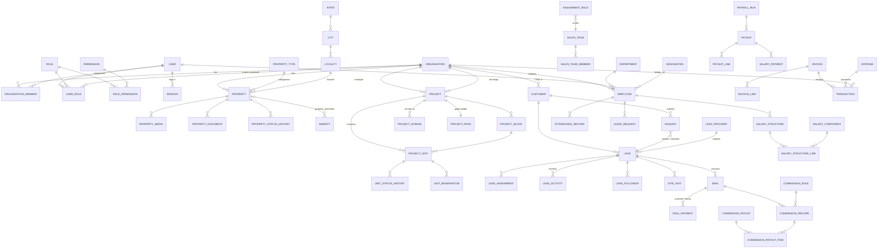

# Database

PostgreSQL 17 with the **PostGIS** and **pg_trgm** extensions. Schema source: `backend/prisma/schema.prisma` (≈90 tables). Migrations: `backend/prisma/migrations` (never edit production tables by hand).

## Conventions

| Topic | Rule |
| --- | --- |
| Keys | UUID v7 (`@default(uuid(7))`) — time-ordered for index locality |
| Naming | snake_case plural tables (`@@map`), camelCase columns (quote them in raw SQL: `"createdAt"`) |
| Money | `numeric(14,2)` INR; calculations in integer paise (`@estate/shared/money`) |
| Areas | `numeric`, plus `areaSqft` normalised for search/sort |
| Time | `timestamptz(3)` for instants; `date` for calendar days (attendance, leave, payroll periods) |
| Deletion | Soft delete (`deletedAt`) for users, organisations, listings, projects, leads, customers, employees |
| Tenancy | `organizationId` on every business record |
| Integrity | Foreign keys everywhere; CHECK constraints for prices, areas, coordinates, booking windows, amounts paid ≤ amount, payroll month |
| Concurrency | `version` columns + conditional updates for unit inventory; status-guarded updates for lifecycles |
| Search | GIN trigram indexes on listing titles, project names, cities and localities; composite B-tree indexes for filters; GiST index on `geography` columns |
| Audit | `audit_logs` (actor, action, entity, before/after JSON with secrets redacted) |

### Custom SQL in migrations
- `estate_sync_location()` trigger keeps `properties.location` and `projects.location` (`geography(Point,4326)`) in sync with latitude/longitude.
- CHECK constraints listed above. `prisma migrate dev` was verified to produce an empty diff with these in place.

### Workflow
```bash
# change schema.prisma, then:
npm run db:migrate -- --name describe_change   # creates + applies a migration in development
npm run db:deploy                               # applies pending migrations (CI / staging / production)
```

## Entity-relationship overview

Core entities and their relationships (attributes trimmed for readability).



## Table map (requested entity → table)

| Requested | Table(s) |
| --- | --- |
| users, sessions | `users`, `sessions`, `verification_tokens` |
| organizations, organization_members | `organizations`, `organization_members` |
| roles, permissions, user_roles | `roles`, `permissions`, `role_permissions`, `user_roles` |
| departments, designations | `departments`, `designations` |
| locations (country/state/city/locality) | `countries`, `states`, `cities`, `localities` (PIN code on locality and listing) |
| broker_profiles, broker_documents, broker_subscriptions | `broker_profiles`, `organization_documents`, `subscription_plans`, `broker_subscriptions` |
| broker_teams | organisation members + `sales_teams` |
| developer_profiles, developer_documents | `developer_profiles`, `organization_documents` |
| properties / property_listings | `properties` (one row per listing; lifecycle in `property_status_history`) |
| property_images, property_documents, property_features | `property_media`, `property_documents`, `property_amenities` + `highlights` |
| property_enquiries / project_enquiries | `enquiries` (one table with property/project/unit references) |
| property_viewings | `site_visits` |
| property_favourites | `property_favourites` |
| projects and children | `projects`, `project_domains`, `project_images`, `project_documents`, `project_amenities`, `project_blocks`, `project_units`, `project_nearby_places`, `project_faqs`, `project_construction_updates`, `project_team_members`, `project_pages`, `project_page_revisions` |
| project_bookings, project_booking_history | `deals` (bookings) and `project_reservations`; `project_booking_history` (unit status history) |
| customers, customer_profiles, customer_preferences | `customers`, `customer_preferences` |
| leads and CRM | `leads`, `lead_sources`, `lead_providers`, `lead_assignments`, `lead_assignment_rules`, `sales_teams`, `sales_team_members`, `lead_activities`, `lead_followups`, `campaigns`, `deal_payments` |
| employees and HR | `employees`, `employee_documents`, `attendance`, `attendance_corrections`, `shifts`, `holidays`, `leave_types`, `leave_balances`, `leave_requests`, `employee_tasks` |
| payroll | `salary_components`, `salary_structures`, `salary_structure_components`, `payroll_runs`, `payslips`, `payslip_lines`, `salary_payments`, `payroll_adjustments` |
| commissions | `commission_rules`, `commission_records`, `commission_payouts`, `commission_payout_items` |
| finance | `transactions`, `expense_categories`, `expenses`, `invoices`, `invoice_lines`, `reimbursements` |
| CMS | `cms_pages`, `cms_sections`, `cms_banners`, `cms_media`, `faqs`, `seo_overrides` |
| notifications | `notifications`, `notification_templates`, `communication_logs` |
| system | `audit_logs`, `system_settings`, `feature_flags`, `reference_counters`, `stored_files` |
