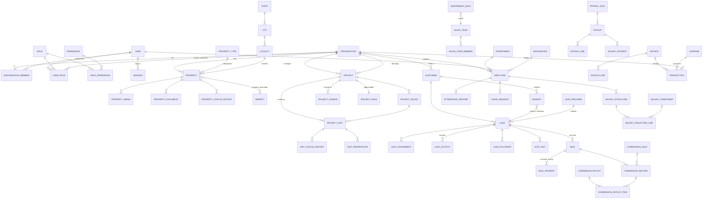

# Database

**MongoDB** (Atlas in production; a single-node replica set locally — Prisma needs a replica set for
transactions). Schema source: `backend/prisma/schema.prisma` (≈100 collections), Prisma **6.19** (Prisma 7
does not support MongoDB yet). There are no migrations: `prisma db push` creates collections and the
schema's indexes, and `backend/src/prisma/database-rules.ts` adds what the schema cannot declare.

## Conventions

| Topic | Rule |
| --- | --- |
| Keys | UUID v7 strings in `_id` (`@default(uuid(7)) @map("_id")`) — time-ordered, the format the API validates |
| Naming | snake_case plural collections (`@@map`), camelCase fields |
| Money | `Float` rupees; every calculation in integer paise (`@estate/shared/money`) — never add stored floats directly |
| Areas | `Float`, plus `areaSqft` normalised for search/sort |
| Time | `DateTime` instants; calendar days (attendance, leave, payroll periods, invoice dates…) are stored at UTC midnight |
| Deletion | Soft delete (`deletedAt`) for users, organisations, listings, projects, leads, customers, employees |
| Tenancy | `organizationId` on every business record |
| Integrity | References checked on every write; collection validators for prices, areas, coordinates, booking windows, amounts paid ≤ amount, payroll month |
| Concurrency | `version` fields + conditional updates for unit inventory; status-guarded updates for lifecycles; lock documents + automatic retries for transactions on the same record |
| Search | Composite indexes for filters; 2dsphere index on `location`; typo-tolerant locality suggestions (trigram similarity in the API) |
| Audit | `audit_logs` (actor, action, entity, before/after JSON with secrets redacted) |

## What the MongoDB layer guarantees

PostgreSQL gave these for free; `backend/src/prisma` provides them (tested in `backend/test/mongo.int-spec.ts`):

| Guarantee | How |
| --- | --- |
| `field: null` filters match "not set" | Every create writes all optional fields, `null` when absent (Prisma would leave them out, and MongoDB's `null` filter would then miss them) |
| References exist | Each foreign key written by a create/update is checked inside the caller's transaction → `P2003` (HTTP 409) when missing |
| Literal text search | Prisma turns `contains`/`startsWith`/`endsWith` (and case-insensitive `equals`/`in`) into regular expressions without escaping; the guard escapes filter text, so `+91…` and `(x)` mean themselves and patterns cannot be injected |
| Calendar dates | Former `DATE` fields are truncated to UTC midnight on write |
| `location` follows latitude/longitude | GeoJSON point set on create/update of properties and projects |
| CHECK constraints | Collection validators (`database-rules.ts`); a violation is HTTP 400 `INTEGRITY_CHECK` |
| Unique when set | Partial unique indexes: `users.email`, `users.phone`, `customers(organizationId, phone)` |
| Sequences | `reference_counters` via one atomic `findAndModify` (also inside transactions) |
| Row locks / advisory locks | `lockInTransaction(tx, key)` writes a lock document; MongoDB aborts the later of two conflicting transactions and `DbClient.$transaction` retries it (up to 8 attempts) |
| Single-instance jobs | `PrismaService.withJobLock` — an expiring lease in `job_locks` |
| Enum order, nulls last | MongoDB sorts enums alphabetically and nulls first; `common/ordering.ts` restores declaration order / nulls last where screens rely on it |

Rules for new code: create clients with `DbClient` (never `new PrismaClient()`), keep transaction callbacks
free of side effects (they may be retried), and add new optional unique fields to
`PARTIAL_UNIQUE_INDEXES`, new calendar-date fields to `DATE_ONLY`.

### Workflow
```bash
# change schema.prisma, then:
npm run db:deploy      # prisma db push: collections + indexes (stops instead of losing data)
npm run db:seed        # reference data (+ demo data outside production); also installs indexes/validators
```
Drop and rebuild a local database: stop the API, `mongosh "mongodb://localhost:27018/basera?directConnection=true" --eval "db.dropDatabase()"`, then the two commands above.

## Entity-relationship overview

Core entities and their relationships (attributes trimmed for readability).



## Table map (requested entity → table)

| Requested | Table(s) |
| --- | --- |
| users, sessions | `users`, `sessions`, `verification_tokens` |
| organizations, organization_members | `organizations`, `organization_members` |
| roles, permissions, user_roles | `roles`, `permissions`, `role_permissions`, `user_roles` |
| departments, designations | `departments`, `designations` |
| locations (country/state/city/locality) | `countries`, `states`, `cities`, `localities` (PIN code on locality and listing) |
| broker_profiles, broker_documents, broker_subscriptions | `broker_profiles`, `organization_documents`, `subscription_plans`, `broker_subscriptions` |
| broker_teams | organisation members + `sales_teams` |
| developer_profiles, developer_documents | `developer_profiles`, `organization_documents` |
| properties / property_listings | `properties` (one row per listing; lifecycle in `property_status_history`) |
| property_images, property_documents, property_features | `property_media`, `property_documents`, `property_amenities` + `highlights` |
| property_enquiries / project_enquiries | `enquiries` (one table with property/project/unit references) |
| property_viewings | `site_visits` |
| property_favourites | `property_favourites` |
| projects and children | `projects`, `project_domains`, `project_images`, `project_documents`, `project_amenities`, `project_blocks`, `project_units`, `project_nearby_places`, `project_faqs`, `project_construction_updates`, `project_team_members`, `project_pages`, `project_page_revisions` |
| project_bookings, project_booking_history | `deals` (bookings) and `project_reservations`; `project_booking_history` (unit status history) |
| customers, customer_profiles, customer_preferences | `customers`, `customer_preferences` |
| leads and CRM | `leads`, `lead_sources`, `lead_providers`, `lead_assignments`, `lead_assignment_rules`, `sales_teams`, `sales_team_members`, `lead_activities`, `lead_followups`, `campaigns`, `deal_payments` |
| employees and HR | `employees`, `employee_documents`, `attendance`, `attendance_corrections`, `shifts`, `holidays`, `leave_types`, `leave_balances`, `leave_requests`, `employee_tasks` |
| payroll | `salary_components`, `salary_structures`, `salary_structure_components`, `payroll_runs`, `payslips`, `payslip_lines`, `salary_payments`, `payroll_adjustments` |
| commissions | `commission_rules`, `commission_records`, `commission_payouts`, `commission_payout_items` |
| finance | `transactions`, `expense_categories`, `expenses`, `invoices`, `invoice_lines`, `reimbursements` |
| CMS | `cms_pages`, `cms_sections`, `cms_banners`, `cms_media`, `faqs`, `seo_overrides` |
| notifications | `notifications`, `notification_templates`, `communication_logs` |
| system | `audit_logs`, `system_settings`, `feature_flags`, `reference_counters`, `stored_files` |
