# Listing workflow

## Who can list
Brokerages, developers, individual owners (each an organisation) and the platform company. Partner organisations self-register as **PENDING**; they can prepare and submit listings, but a listing can only be approved/published once the organisation is **ACTIVE** (verified by staff with `broker.verify` / `developer.verify`).

## Category-specific data
Each property type maps to a form profile (plot, apartment, house, commercial unit, commercial building, industrial, agricultural). The profile decides which fields apply and which are required; non-applicable fields are rejected (`validatePropertyForProfile`, shared by console and API). Areas are normalised to square feet for search; price per sq.ft is derived for sale listings.

## Lifecycle

```mermaid
stateDiagram-v2
  [*] --> DRAFT
  DRAFT --> PENDING_REVIEW: submit (needs ≥1 photo, complete details)
  PENDING_REVIEW --> DRAFT: withdraw
  PENDING_REVIEW --> APPROVED: approve (reviewer; org must be ACTIVE)
  PENDING_REVIEW --> REJECTED: reject (reason required)
  APPROVED --> PUBLISHED: publish (automatic when "auto-publish on approval" is on)
  REJECTED --> DRAFT: revise
  PUBLISHED --> PENDING_REVIEW: material edit by lister (price, area, location, photos…)
  PUBLISHED --> SOLD: mark sold (sale listings)
  PUBLISHED --> RENTED: mark rented (rent listings)
  PUBLISHED --> EXPIRED: validity ends (scheduler)
  EXPIRED --> PENDING_REVIEW: renew
  RENTED --> DRAFT: relist
  DRAFT --> ARCHIVED
  PUBLISHED --> ARCHIVED
  SOLD --> ARCHIVED
  ARCHIVED --> DRAFT: restore
```

- Only `PUBLISHED` listings of `ACTIVE` organisations appear in search. Sold/rented/expired listing pages stay reachable for shared links but are marked unavailable and do not accept enquiries.
- Every change is recorded in `property_status_history` and the audit log; reviewers and listers are notified.
- Transitions use a status-guarded update — two reviewers acting at once cannot both succeed.
- Validity (`listing.validityDays`, default 90) and re-review on edit (`listing.requireReviewOnEdit`) are admin settings.
- Subscription quotas are enforced at publish time when `subscriptions.enforceQuota` is on.

## Verification badge
Separate from publication: reviewers mark a listing **Verified** after checking ownership/authorisation documents uploaded privately to the listing.
