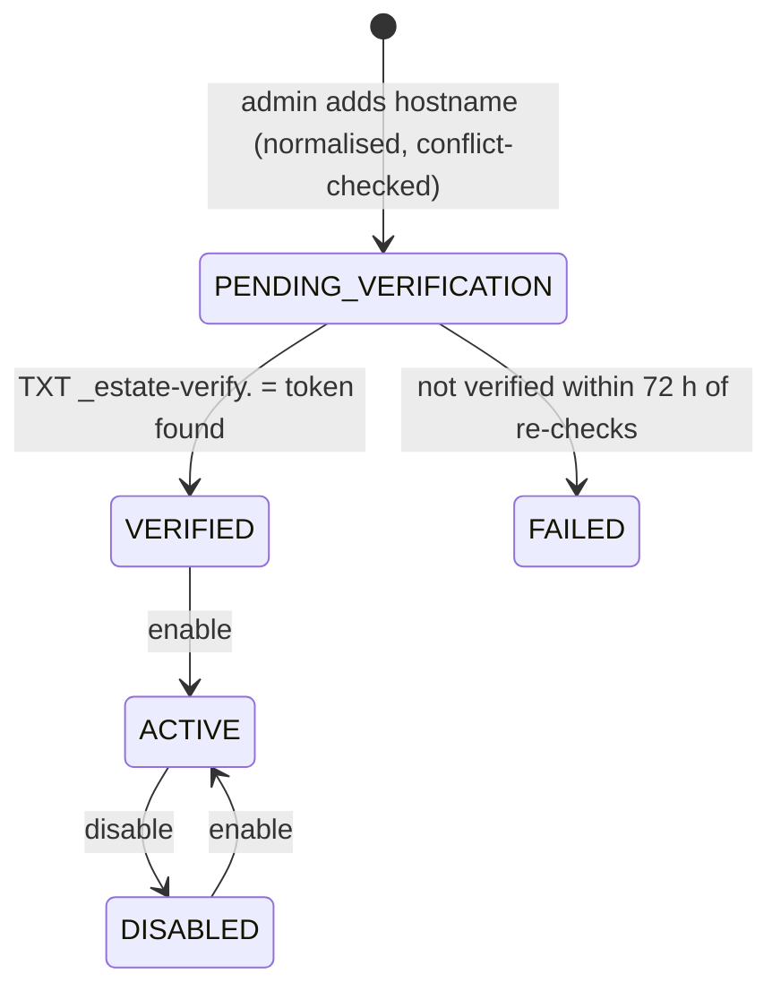

# Projects, inventory, microsites & domains

## Project lifecycle

| Status | Meaning |
| --- | --- |
| DRAFT | Being prepared; never public |
| UPCOMING / PRE_LAUNCH | Announced; booking not open yet |
| BOOKING_OPEN | Bookings accepted |
| CLOSING_SOON | Booking open, closes within the configured window (default 72 h) |
| SOLD_OUT | No released unit is available |
| CLOSED | Booking window ended |
| COMPLETED | Delivered |
| ARCHIVED | Hidden |

- With **automatic status** on, the server derives the sales status from `bookingOpensAt`, `bookingClosesAt`, the closing-soon window and live inventory (`computeProjectStatus` in `@estate/shared`). A scheduler persists changes every minute (with history and team notifications) and every read computes the effective status, so the public site is correct even between scheduler runs. Countdown timers on the website are display-only.
- Manual changes follow `PROJECT_STATUS_TRANSITIONS`; sales statuses cannot be set by hand while automatic status is on.
- **Review & publication**: developer projects need platform approval unless the developer's organisation is set to direct publishing; publishing requires the managing organisation to be active.

## Inventory
Blocks/towers/sectors contain units (plots, flats, shops, offices…) with area, facing, base price and additional charges. Unit transitions follow `UNIT_STATUS_TRANSITIONS`; every change is written to `project_booking_history`. Reservations are allowed only while booking is open and use a version-checked conditional update, so concurrent reservations of the same unit cannot both succeed. Holds and reservations expire automatically.

## Page builder
A project page is an ordered list of typed sections (hero, overview, key facts, gallery, master plan, inventory, amenities, map, nearby, developer, documents, construction updates, FAQs, testimonials, contact, call to action). Each section's settings are validated (`SECTION_DATA_SCHEMAS`); dynamic content (units, amenities, FAQs, media) is read live from the project's records. Editors save drafts, preview them with an expiring token, publish (creating a revision) and restore older revisions. No HTML or script is ever stored or rendered from the database.

## URLs
1. **Main domain**: `https://brand.in/projects/<slug>`
2. **Platform subdomain**: `https://<label>.brand.in` — the platform controls the zone (wildcard DNS), so subdomains are active immediately.
3. **Custom domain**: `https://www.project-name.in`

`frontend/web/proxy.ts` resolves non-platform hosts through `GET /api/v1/public/domains/resolve` and rewrites them to the project microsite. Unknown or unverified hosts return 404, and the internal `/site/*` path is never reachable directly on a mapped host.

**Canonical address & SEO.** A project's canonical URL is its *primary* domain when one is set (console → Domains → "Make primary address"), otherwise the marketplace page `/projects/<slug>`. On a mapped host, `robots.txt` and `sitemap.xml` are the microsite's own: only the canonical host advertises and serves a sitemap (listing the microsite page); the marketplace sitemap omits projects whose canonical address is their own domain.

## Custom domain verification

1. The console shows the DNS records to create: a **TXT** record `_estate-verify.<hostname>` with the verification token, and a **CNAME** to `CUSTOM_DOMAIN_CNAME_TARGET` (or an A record to `CUSTOM_DOMAIN_A_RECORD`).
2. "Verify now" (and a background re-check every 15 minutes) looks the records up with real DNS queries. Failures are stored with the exact reason; a domain is never activated without a matching TXT record.
3. Hostnames are unique across the platform; a hostname held by another organisation is refused; platform and reserved hostnames cannot be claimed.
4. **TLS**: certificates are not assumed. With `TLS_PROVIDER=caddy-on-demand`, Caddy asks `GET /api/v1/public/domains/tls-check?domain=` before issuing a certificate, and the API approves only ACTIVE domains. With another proxy/CDN, configure its custom-hostname feature and the SSL status shows "managed externally".
